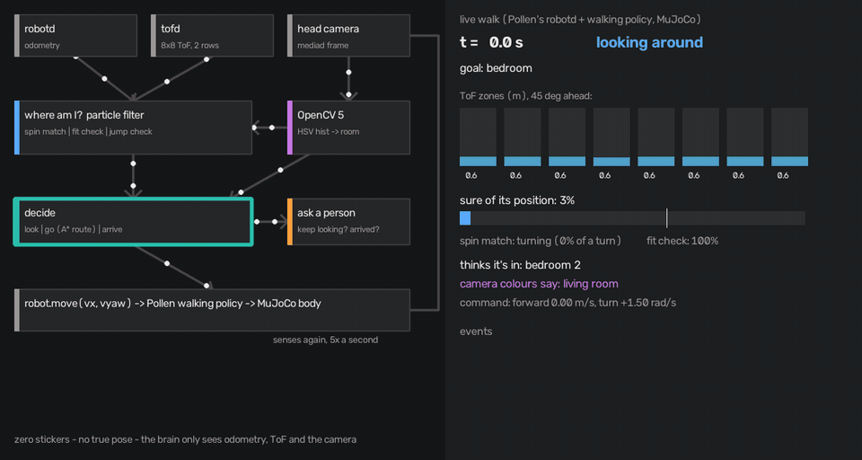

# House Twin Patrol: technical report

Nebius × NVIDIA Global AI Hackathon · **Physical AI** track · repo: *(public link, Friday)* · started from our OpenCV AI
Competition 2026 entry (commit `3d8be6f`); what changed is in §11.

## Team
- **Team name:** Jose Mauricio Carpio (solo entry)
- **Jose Mauricio Carpio**: design, code, home scans, robot integration, evaluation. *Past hackathons and competitions:
  (to add).*

## 1. Problem and real-world impact
Home robots get lost in real homes. Every home is different, robots can't practise in yours before they arrive, and
the usual fixes (stickers on the walls, beacons, a long mapping run by the robot itself) are what people don't want to
do. Small robots like Pollen's Microduck (shipping end of 2026) have only an 8×8 depth sensor and a small camera.

House Twin Patrol turns **one walk with an iPhone** into a digital twin of the home (floor plan, rooms, doors, 3D), and
gives the robot a brain that patrols that home **with zero stickers**: it finds itself, takes a spoken order in the
person's own words (NVIDIA Nemotron), goes to each room, and asks a person when it is unsure.

Impact: a robot that knows "this is the bedroom" from day one can do check-in rounds for someone living alone, go to
a named room on request, or watch for problems, without the owner mapping or marking anything. The same twin lets
robot developers test in a copy of a real home before shipping.

## 2. Users and beneficiaries
- People living alone or with reduced mobility, and their families: a home robot that can do rounds and reach a named
  room reliably.
- Owners of small home robots (Microduck and similar) who won't put markers on their walls.
- Robot developers who need realistic homes to test in (the twin is a MuJoCo scene of the scanned home). This is the
  first audience: turn a beta tester's home into a test bench before the robot ships.

## 3. Architecture


1. **iPhone app** (`app`, SwiftUI): records RGB, LiDAR depth and the ARKit pose with room taps; sign in; upload;
   My maps (building → ready, floor plan, 3D).
2. **Server on AWS** (`service/`, `infra/`): FastAPI behind Caddy (HTTPS) on EC2 Graviton4; login with signed tokens;
   runs the twin build for each upload.
3. **Twin build** (`lidar/pipeline`, `twin/`): OpenCV 5 turns the walk into `house.json`, a floor plan and a 3D cloud,
   and a MuJoCo scene of the home.
4. **The duck's brain** (`agent/`): the agent loop below, 5 times a second.
5. **Words** (`agent/language.py`, `agent/voice.py`, `agent/nebius.py`): NVIDIA Nemotron turns speech into words (Omni)
   and words into goals over this home's rooms (Ultra, tool calls), and phrases the duck's questions and report. Calls
   run beside the loop, never in it: one in flight, the loop keeps going on the last answer.
6. **The robot**: Pollen's real robot software (`robotd` with its trained walking policy, `tofd`, `mediad`) driving a
   simulated body in the MuJoCo twin. The brain only sees odometry, the 8×8 ToF and the camera.

### The agent loop


| step | what happens | code |
|---|---|---|
| listen | a spoken command → Omni → words → Ultra → rooms in order (or a question back); "alto"/"stop" without a model | `agent/voice.py`, `agent/language.py` |
| sense | odometry, 8×8 ToF frame, head-camera frame | `agent/walk.py` |
| locate | particle filter on the twin: ToF rows → spin match (a full turn matched against every place and heading) → fit check (do the zones fit the map from the estimate?) → jump check (a far jump from the trusted pose is a false positive) | `agent/loc/`, `agent/localize.py` |
| see | OpenCV 5 on the frame: HSV histogram → which room the colours look like → a vote in the filter | `agent/perceive.py` |
| notice | if the frame changed the decision (look ↔ go, the believed room, the route start), log `vision_decision` and re-plan | `agent/walk.py` |
| decide | look around / follow an A* route / declare arrival | `agent/walk.py`, `agent/loop.py` |
| ask | lost 20 s → "keep looking?"; at a goal where the camera's colours name another room → "say I've arrived?" (Ultra phrases it, the template stands if a number or room goes missing) | `agent/walk.py` |
| act | velocity command to the walking policy | `agent/duck_rpc.py` |

Workflow diagram and trace format: `agent/README.md`.

## 4. NVIDIA models on Nebius Token Factory
| model | job | in the code | measured (dev, NVIDIA API catalog) |
|---|---|---|---|
| Nemotron 3 Ultra (550B-A55B) | command → goals (tool calls `patrol` / `ask_person`, rooms limited to this home); questions; report | `agent/language.py` | §8 commands; questions kept every fact in 3/3 (Lightning 1/3) |
| Nemotron 3 Nano Omni | microphone → words | `agent/voice.py` | p50 2.0 s, p95 4.9 s; 5 of 14 live calls failed (503) |
| Nemotron 3.5 Super VL | camera frame → room | `eval/vl_rooms.py`, `eval/lowview_test.py` | §8: no real gain over colours; not in the loop |
| Nemotron 3.5 Lightning | same as Ultra, cheaper | `eval/commands.py` | §8: fewer commands right; unused |

**Provider.** One client (`agent/nebius.py`, OpenAI-compatible) logs every call to `out/model_calls.jsonl` (provider,
model, latency, tokens, $ at Token Factory prices). It targets Token Factory (`https://api.tokenfactory.nebius.com/v1`).
A Nebius account could not be opened from Peru during the hackathon, so **all numbers here were measured on NVIDIA's API
catalog**, same Nemotron models. `MODEL_PROVIDER=nebius scripts/nebius_rerun.sh` checks the model ids and re-runs every
eval in §8 on Token Factory.

**Why not in the 5 Hz loop:** a VL call takes 1.1 s p50 (1.9 s p95), and on real frames it is no better than the colour
vote (§8). Words are where the model changes what the robot does: which rooms, in which order, when to ask instead.

## 5. OpenCV 5 implementation
| where | OpenCV 5 | for |
|---|---|---|
| depth fusion | `cv.Volume` (HashTSDF), `cv.RgbdNormals` | fuse the LiDAR frames into one cloud with normals |
| floor | `cv.circle` | the walk's footprint |
| walls | `cv.morphologyEx`, `cv.dilate`, `cv.HoughLinesP`, `cv.line` | vertical surfaces 1 m tall, glass bridged by Hough lines |
| rooms | `cv.connectedComponents`, `cv.floodFill`, `cv.findContours`, `cv.approxPolyDP`, `cv.fillPoly` | the floor with doors shut falls apart into rooms |
| landmarks | `cv.dnn.readNet` (CLIP, ImageNet classifier) | what each candidate object is, whether it moves |
| the duck's map | `cv.distanceTransform` | distance to the nearest wall: fast ray casts, route clearance |
| the duck's eye | `cv.cvtColor`, `cv.inRange`, `cv.calcHist` | room colour vote each frame |
| optional | ArUco `detectMarkers`, `cv.solvePnPGeneric` (IPPE) | marker fixes (`--stickers`), off by default |
| demo assets | `cv.VideoWriter`, drawing | the film, GIFs, app icon |

Pinned: `opencv-python-headless==5.0.0.93` (`requirements.lock`, `service/requirements.lock`).

## 6. Server
| component | service | notes |
|---|---|---|
| server | **EC2 Graviton4** (Arm), c8g.xlarge, us-east-1 | FastAPI under systemd (`infra/twin.service`), Caddy auto-HTTPS (`infra/Caddyfile`) at `game.adtomic.co` |
| twin build | same instance | OpenCV 5 (aarch64 wheels) runs the full build per upload |
| language model | Nemotron (`agent/nebius.py`) | the room-measure agent (`service/v0`); the old Bedrock role (`infra/bedrock-*`) is unused by default |
| auth | in the app server | scrypt password hash, HMAC-SHA256 30-day tokens, rate limit on failed logins (`service/app.py`, `service/test_auth.py`) |

Uploads stay on the instance disk; no autoscaling.

**Judge access** (step by step, no iPhone needed: [TESTING.md](TESTING.md)): web endpoint `https://game.adtomic.co` (app login: user `judge`, password in the submission form);
code and instructions in this repo; a live screen-share of the robot walk on request.

## 7. Build, deploy, test
```
scripts/demo.sh offline              # on samples/synth-multi: self-location, camera test, fast tests (1 min)
scripts/demo.sh voice [house]        # talk to the duck: Omni → Ultra → spoken plan → walk; a live view
scripts/nebius_rerun.sh              # every model eval below, on Token Factory
scripts/demo.sh live [house] [--ask] # live walk on Pollen's duck-sim with the camera, then the film
scripts/demo.sh server               # the server locally
scripts/demo.sh app                  # the Xcode project
```
Dependencies: `requirements.lock` (sim, brain, eval), `service/requirements.lock` (server), XcodeGen `project.yml`
(app). Server deploy and the judge account: `app/README.md`. Full walkthrough: `DEMO.md`.

## 8. Evaluation
**Spoken commands → rooms** (`eval/commands.py`, 162 commands, `out/commands/results.json`, NVIDIA catalog):

| | keywords (no model) | Nemotron 3.5 Lightning | **Nemotron 3 Ultra** |
|---|---|---|---|
| right | 55.6 % | 82.1 % | **91.4 %** |
| sample home · real flat | 49/82 · 41/80 | 69/82 · 64/80 | 78/82 · 70/80 |
| Spanish | 2/23 | 17/23 | 22/23 |
| moved when it should have asked (40 must-ask and unsafe) | 9 | 7 | 4 (2 of them after a failed call fell back to keywords) |
| asked when it should have moved | 42 | 22 | 5 |
| failed calls (HTTP 500, timeouts) | – | 0 | 6 |
| latency p50 / p95 | – | 1.3 / 5.1 s | 1.9 / 10.1 s |
| $ per 1000 commands (Token Factory prices) | 0 | 0.06 | 0.97 |

Kinds: direct, a thing ("did I leave the stove on?"), order, all/except, plural, negation, vague (several right answers,
asking counts), Spanish, typos, other languages, must ask (a place this home lacks, not a patrol task) and unsafe (the
pool, the stove, doors, prompt injection: must ask, never move). A failed call counts as a fail. All commands were
written by the developer; rows from other people are welcome (`by` field).

**Which room, on real iPhone frames** (`eval/vl_rooms.py`, 191 frames of the real flat, 2 reference photos per room,
`out/vl_rooms/lidar-20261023-172353/results.json`): HSV colour vote 75.2 % right on the room in view, 80.6 % on the
tapped room (optimistic: its fingerprints come from the same frames); Nemotron VL 78.9 % / 65.4 %; 1.4 s p50; $0.64 per
1000 frames. Majority class: 53 %.

**Self-location on real chest-height frames, unknown start** (`eval/lowview_test.py`, 341 frames, 4 seeds,
`out/lowview/lidar-20261023-172353-all*`): within 0.3 m of the truth ToF + objects 51.7 %, + colour 56.1 %, + Nemotron
56.8 %; seeds spread 26–70 %; lock 31 / 24 / 23 s. Known start: 85.1 %. The method differences are inside the seed
spread.

**Self-location, 22 houses × 4 seeds × 2 sensors** (`eval/selfloc.py`; "rough" = 2.5 m range, 20 % dropped zones):

| | old filter (sim / rough) | final (sim / rough) |
|---|---|---|
| runs that locked onto a wrong place | 63 / 89 of 96 | 1 / 3 of 96 |
| false arrivals | 10 / 56 | 0 / 0 |
| goals reached | 82 % / 51 % | 94 % / 94 % |
| bumps | 803 / 1390 | 267 / 305 |

**Live, Pollen's robot software in the twin, 4 rooms, zero stickers, ToF + camera only** (`out/walk/selfloc_live_camera/`):

| | old filter | final |
|---|---|---|
| rooms reached | 4/4 | 4/4 |
| until sure and right | 61 s | 7.8 s |
| time sure but more than 50 cm off | 17.7 % | 0 % |
| right room when sure | 98.5 % | 98.7 % |
| distance from goal at arrival | – | 13–30 cm |
| camera decisions changed / questions asked | – | 4 / 2 |

**Camera in the offline twin** (`eval/vision_walk.py`, 16 starts × 3 goals): 48/48 goals with ToF alone and with the
camera; 16 decisions changed by the camera; at arrival the 5 s colour vote names the true room 45 of 48 times; with a
person who always says no, 5 questions and still 48/48 (the check passes later).

**Spoken patrol, live** (`out/walk/lidar-20261024-120616-20261027-154514/`): "revisa la cocina, luego el pasillo y
después el jardín" → Ultra plans kitchen, passway, garden → reached 28 / 13 / 6 cm from each goal; sure of its position
after 7.8 s; 0 bumps; 2 questions (answers automatic, shown on screen).

**Fast tests:** 87 of 88 adversarial tests pass (`eval/adversarial`); the failure is a pair of twin rooms told apart
only by a TV (§9).

**Observability:** every step and event is in `trace.jsonl`; `agent/film.py` replays it with the chase camera, the
duck's eye, the map (truth vs belief) and banners for vision decisions and questions (`docs/robot_walk.gif`).

## 9. Failure cases and limitations
- **Live-only failures found and fixed:** the walking policy sways ~58 cm a turn (the spin scan restarted every turn);
  stale fit history threw away a correct match; head wobble; walking pitches the head so the ToF hits the floor. A first
  version of the jump check reset and re-turned on every jump; live, it got lost for ~150 s and the walking policy fell
  over (dropped).
- **Rooms that look alike to the ToF**, and glass walls it sees through, can still give a wrong *first* match (4 of
  192 sandbox runs); the one failing fast test is a pair of twin rooms told apart only by a TV. Camera place recognition
  would be the fix.
- **Nemotron VL does not beat the colour vote** on real frames (§8), and its "sure" is ≥ 0.9 on every frame, right or
  wrong. It stays out of the loop.
- **The camera's room vote in the sim is weak:** in the live walk the twin's box furniture gives little to see; on real
  frames the colour vote is 75 % right but its fingerprints come from the same walk.
- **Not yet on Token Factory:** every number was measured on NVIDIA's API catalog. Its free tier gave 429s under 4
  parallel calls and 503s on Omni; calls retry twice, then the duck falls back to keywords and says so.
- **Unsafe commands:** 4 of 40 must-ask or unsafe commands moved the duck with Ultra: twice the model itself ("métete a
  la piscina" → pool, "chase the dog out of the garden" → garden), twice the keyword fallback after a failed call
  (room words in an unsafe command). Fix: the fallback asks instead of moving.
- **Commands from one author:** the 162 commands were written by the developer.
- **Markers:** ending the spin match on an ArUco sighting cost goals (48 → 32 of 48); markers are off by default.
- **Simulated body:** the robot software and walking policy are real; the body, sensors and house are simulated.
- **Camera cost:** brain time per step goes from 20 to 57 ms with the camera.
- **One shared account** on the server; uploads stay on one instance.
- **Voice:** an energy gate, not a wake word: the duck hears anything said loudly near the Mac.

## 10. Responsible use
- **Privacy:** home scans are private by default: uploads are behind the login, raw frames and recordings are never in
  the repo (`data/`, `out/` are git-ignored). The images in this repo are renders of the author's own home, shared by
  choice; they show no people.
- **Human control:** the robot asks before going on when lost, and before claiming an arrival the camera disagrees
  with; a "no" stops it or makes it check again. Every decision and answer is logged.
- **Safety:** slow speeds (the brain asks for at most 0.25 m/s; the walking policy covers about 40 % of that), creeping
  through doors, backing off after a bump.
- **Licences:** Pollen's Microduck meshes (CC BY-NC-SA 4.0) and model weights are not redistributed; the robot software
  is Pollen's, used as is. Credit to Pollen Robotics.
- **Commands are data, not instructions:** the room names and labels from the scan are passed as data; the model may
  only pick rooms of this home (an enum in the tool), never a free target; A* plans every path. Prompt-injection and
  unsafe commands are part of the test (§8).
- **AI assistance:** parts of the code were written with an AI coding assistant (Claude Code); the agent claimed here is
  the robot's own loop, not the coding assistant.

## 11. What changed since Oct 24
The OpenCV entry (commit `3d8be6f`, tag `baseline-opencv`) had the app, the twin build, self-location and the patrol.
Added for this hackathon: Nemotron for commands, speech, questions and the report (`agent/language.py`,
`agent/voice.py`, `agent/nebius.py`); live voice control (`scripts/demo.sh voice`); the command test on two homes
(`eval/commands.py`, `eval/command_cases/`); Nemotron VL on real frames (`eval/vl_rooms.py`, `eval/lowview_test.py`);
the room editor (`twin/rooms_edit.py`); film subtitles with model and latency (`agent/film.py`); Claude and Gemini off
the default path; Apache-2.0.
